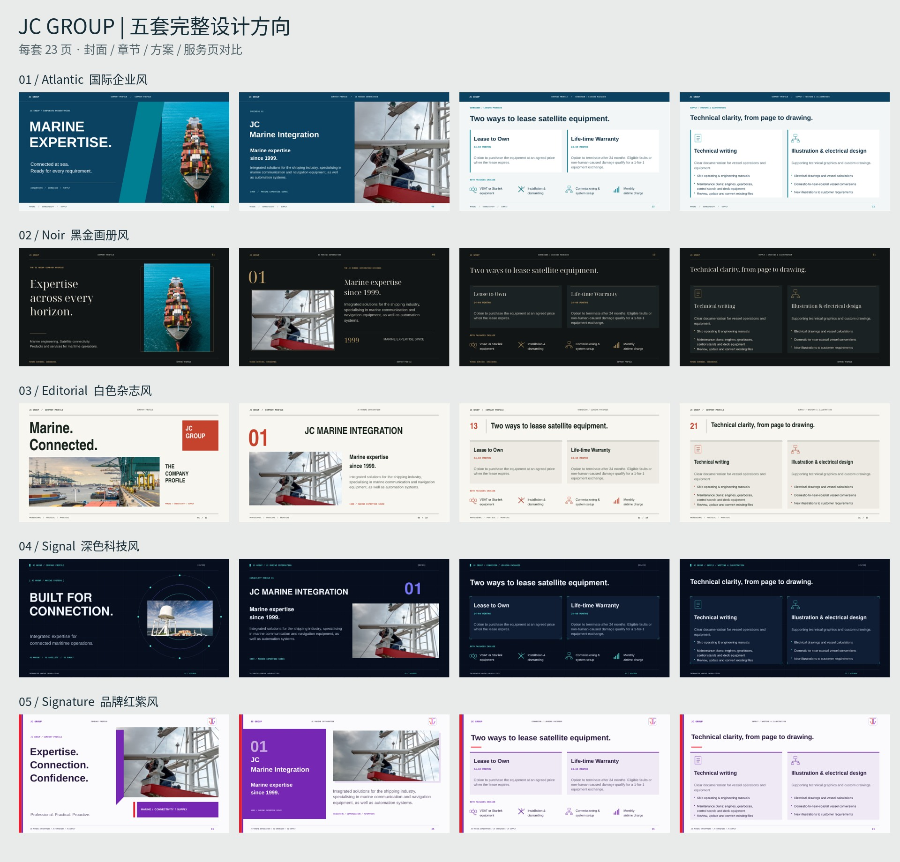

<!-- full-content-latest -->
# 最新完整版：按新内容重建 · 31 页

沿用第 3、5 套设计，均为 **16:9 横屏、每套 31 页**。完整保留新提供的 Vision、三条 Mission、三家公司的 About us 和 5／6／5 类服务，并展开原有服务详情。

| 最新完整版 | 完整可编辑 PPT（31 页） | 完整 PDF（31 页） |
| --- | --- | --- |
| 3 · 白色杂志风 | [下载完整 PPT](./full-content-update/03_Editorial_Full_Content.pptx?raw=true) | [打开全部31页](./full-content-update/03_Editorial_Full_Content.pdf) |
| 5 · 品牌红紫风 | [下载完整 PPT](./full-content-update/05_Signature_Full_Content.pptx?raw=true) | [打开全部31页](./full-content-update/05_Signature_Full_Content.pdf) |

**[下载两套31页完整版合集](./full-content-update/JC_Group_FULL_31pages_03_05.zip?raw=true)**：两份完整 PPT、两份完整 PDF 和说明文件，不含选页预览。

本次更新：

- JC MARINE INTEGRATION、JC SUPPY、JC MARINE TECHNOLOGY 三家登记资料。
- Technology About us 改为 JC Marine Technology Sdn Bhd，2026 年成立，其他内容及服务保留。
- Marine 5 类、Technology 6 类、Supply 5 类服务逐项呈现；完整保留租赁条款、10项供应品及设备清单。
- TEL +6011-8888 5899；邮箱 request@jcmarine.com.my；营业时间和 Miri／Port Klang／Singapore 三个完整地址。
- 简洁封面、地区服务、品牌代理及联络封底保留。

[31页内容目录与全部文件](./full-content-update)

---

# JC Group · 五套完整企业介绍设计

每套 **23 页**，均含可编辑 PowerPoint 和 PDF 预览。资料按三大业务重新归类，统一标题、正文、图片与列表的对齐及间距。

**[先看五版对比 PDF](./five-versions/00_Compare_All_5.pdf?raw=true)** · **[一键下载全部五套 ZIP](./five-versions/JC_Group_5_Designs.zip?raw=true)**

| 版本 | 设计方向 | PowerPoint | PDF |
| --- | --- | --- | --- |
| 01 / Atlantic | 国际企业风 | [下载 PPT](./five-versions/01_Atlantic.pptx?raw=true) | [查看 PDF](./five-versions/01_Atlantic.pdf?raw=true) |
| 02 / Noir | 黑金画册风 | [下载 PPT](./five-versions/02_Noir.pptx?raw=true) | [查看 PDF](./five-versions/02_Noir.pdf?raw=true) |
| 03 / Editorial | 白色杂志风 | [下载 PPT](./five-versions/03_Editorial.pptx?raw=true) | [查看 PDF](./five-versions/03_Editorial.pdf?raw=true) |
| 04 / Signal | 深色科技风 | [下载 PPT](./five-versions/04_Signal.pptx?raw=true) | [查看 PDF](./five-versions/04_Signal.pdf?raw=true) |
| 05 / Signature | 品牌红紫风 | [下载 PPT](./five-versions/05_Signature.pptx?raw=true) | [查看 PDF](./five-versions/05_Signature.pdf?raw=true) |

## 资料结构

1. 集团概况、愿景使命、区域服务范围
2. JC Marine Integration：设备服务、品牌合作、维护检测、罗经服务
3. JC Connexion：卫星资费、设备安装、租赁、流量控制、船舶追踪、IT 网络
4. JC Supply：产品分类、校准与制作、火警系统、技术文档
5. 公司登记资料、联系方式与营业时间

## 使用说明

打开文件后可点击右上角 **↓ Download raw file** 下载。五套完整文件也已放入 ZIP，便于一次保存。

资料与照片依据用户提供的 2025-10-28 公司介绍。原稿中 `JC SUPPY SDN BHD` 与 `JC Supply Sdn Bhd` 拼写不一致，登记信息页保留原封面拼写，正式使用前请核对。

[之前版本的 PPT](./JC_Group_Premium_Profile.pptx?raw=true) / [之前版本的 PDF](./JC_Group_Premium_Profile.pdf?raw=true) 仍保留在仓库根目录。
