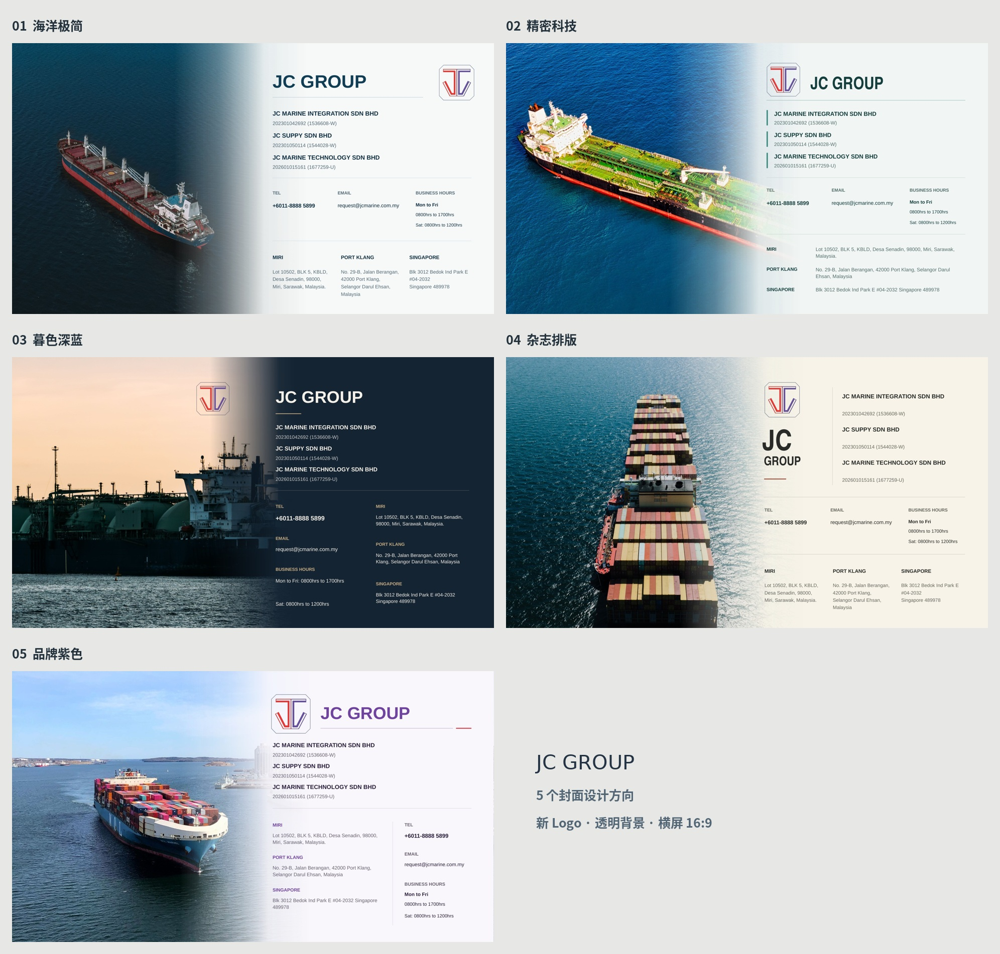

# JC Group · 5 个封面方案

按当前逐页修改流程，本次提供 **5 个封面设计，共 5 页，16:9 横屏**。所有封面均含最新公司登记、联络、营业时间和三个完整地址；不替换已有的 31 页完整公司介绍。

**[查看 5 版总览图](./00_Five_Covers_Overview.jpg)** · **[逐页放大查看 PDF（5 页封面）](./JC_Group_5_Cover_Designs.pdf)** · **[下载可编辑封面 PPT（5 页）](./JC_Group_5_Cover_Designs.pptx?raw=true)** · **[下载整个封面方案包](./JC_Group_5_Cover_Concepts.zip?raw=true)**

| 编号 | 设计方向 | 高清单页图 |
| --- | --- | --- |
| 01 | 海洋极简：完整船舶与深蓝海面，暖白留白，疏朗三栏资料。 | [打开高清图](./01_Atlantic_Minimal.jpg) |
| 02 | 精密科技：斜向船舶航拍，青灰配色，精确对齐与三行地址。 | [打开高清图](./02_Precision.jpg) |
| 03 | 暮色深蓝：暮色实景，深蓝与香槟色，双栏联络及地区资料。 | [打开高清图](./03_Dusk_Signature.jpg) |
| 04 | 杂志排版：甲板俯拍，象牙白，两行大字与并列公司登记。 | [打开高清图](./04_Editorial.jpg) |
| 05 | 品牌紫色：船首与平静港湾，品牌紫色，地址与联络分列。 | [打开高清图](./05_Coastal_Brand.jpg) |

## 透明 JC Logo

使用新上传的 `LOGO.pdf` 矢量原图直接导出，保留标志线条与原有颜色，去除原来图片的白色方块背景。五个封面均使用透明底 Logo。

[下载透明 PNG](./JC_Logo_Transparent.png?raw=true) · [下载透明 SVG 矢量文件](./JC_Logo_Transparent.svg?raw=true)

## 摄影素材

封面图片为海事行业视觉素材，采用 Pexels 免费许可：

- 01：[Aleksandr Sochnev／Pexels](https://www.pexels.com/photo/aerial-view-of-cargo-ship-on-open-sea-30463262/)
- 02：[Tom Fisk／Pexels](https://www.pexels.com/photo/aerial-view-of-ship-3114588/)
- 03：[Edu Raw／Pexels](https://www.pexels.com/photo/large-cargo-ship-at-sea-during-sunset-38646187/)
- 04：[8 K／Pexels](https://www.pexels.com/photo/fully-loaded-cargo-ship-on-a-sea-12530455/)
- 05：[Enrique／Pexels](https://www.pexels.com/photo/ship-in-calm-sea-near-port-4041587/)

[此前两套完整 31 页公司介绍](../full-content-update)
