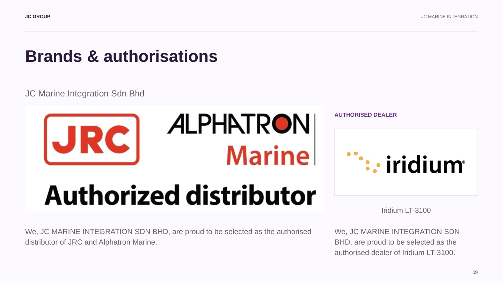
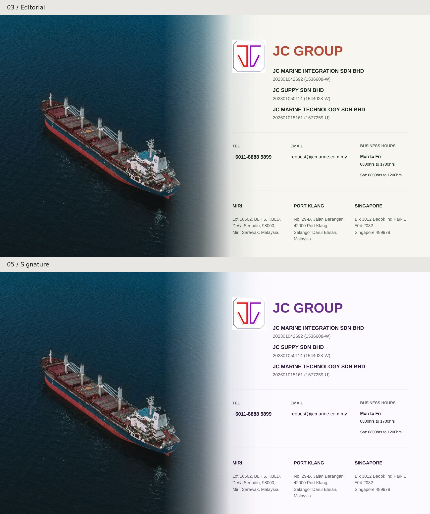

# JC Group · 最新内容完整版（31 页）

沿用第 3、5 套设计，均为 **16:9 横屏、每套 31 页**。本目录所有 PPT 和 PDF 都是完整文件。

| 版本 | 完整可编辑 PPT（31 页） | 完整 PDF（31 页） |
| --- | --- | --- |
| 3 · 白色杂志风 | [下载](./03_Editorial_Full_Content.pptx?raw=true) | [打开全部31页](./03_Editorial_Full_Content.pdf) |
| 5 · 品牌红紫风 | [下载](./05_Signature_Full_Content.pptx?raw=true) | [打开全部31页](./05_Signature_Full_Content.pdf) |

**[下载两套完整版合集](./JC_Group_FULL_31pages_03_05.zip?raw=true)**：两份 PPT、两份 PDF 和本说明，不含选页预览。

## 品牌标识更正

第 9 页按用户确认的第二张图，完整展示 **JRC＋Alphatron Marine＋Authorized distributor** 组合标识。Iridium LT-3100 单独保留经销商类别。

## 新封面

两套封面均换为深蓝海面上的完整船舶航拍实景，构图更简洁。保留中间向右的浅色渐变，以及右侧的 Logo、三家公司及登记号、电话、邮箱、营业时间和三个完整地址；第 3 套沿用暖白与赤陶色，第 5 套沿用浅紫与紫色。文字和渐变均可在 PPT 中编辑。

本次只更换封面主图；右侧资料与排版、其余 30 页均保持一致，每套仍为完整 31 页。

封面摄影：Aleksandr Sochnev／[Pexels](https://www.pexels.com/photo/aerial-view-of-cargo-ship-on-open-sea-30463262/)，使用 Pexels 免费许可，作为海事行业视觉素材。

## 本次内容

- 完整 Vision、三条 Mission、三家公司 About us。
- Marine Integration 五大类、Marine Technology 六大类、Supply 五大类服务，逐项列明并展开原有服务详情。
- Technology 公司名称、2026 年成立及登记号按最新确认更新。
- 100+ VSAT／Starlink 安装段落、原有完整租赁条件及设备清单均保留。
- 更新为 request@jcmarine.com.my；结尾含电话、营业时间及 Miri、Port Klang、Singapore 三个完整地址。
- 封面按最新要求加入公司登记与联络资料；地区页和已更正的品牌代理页保留。

## 页码目录

01 封面；02 公司登记资料；03 Vision；04 Mission；05 Marine About；06 Marine 五类服务；07 导航通信与设备；08 地区服务；09 品牌代理；10 岸基维护；11 VDR／SVDR APT；12 陀螺罗经；13 磁罗经；14 Technology About；15 Technology 六类服务；16 互联网资费；17 流量控制；18 VSAT／Starlink；19 船舶追踪；20 Lease to Own；21 Life-time Warranty；22 IT 网络；23 Supply About；24 Supply 五类服务；25 热工作业与制作；26 船舶用品；27 火警系统；28 技术写作；29 技术插图；30 校准与大修；31 联络与三处地址。

工作照片沿用原 PPT 素材；文字仅修正明显拼写，不以摘要替换用户提供的完整段落。
