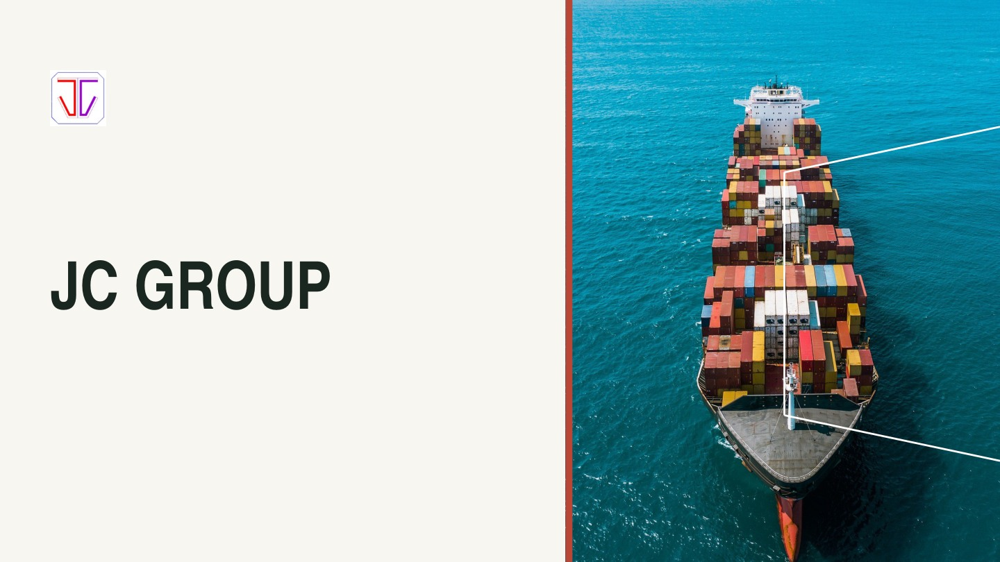
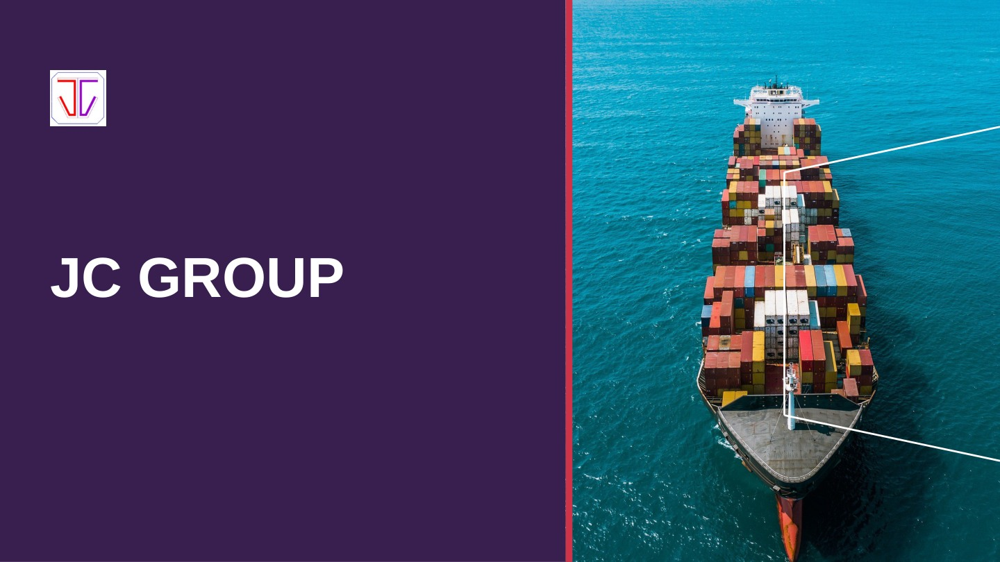

# JC Group · 第 3、5 套 16:9 横屏版

两套均为标准 **16:9 横屏，每套 22 页**，已按横向空间重新安排图文比例与内容位置。

- 首页只保留公司名称、标志和主图。
- 资料顺序沿用整理后的集团、海事服务、卫星通信、船舶供应。
- 地区服务和品牌代理页均已改为横屏构图，照片与 Logo 保持原比例。
- 最后一页集中列出联络方式、地址及营业时间。

**[横屏重点页预览](./00_Landscape_Preview.pdf?raw=true)** · **[下载两套横屏 PPT＋PDF](./JC_Group_03_05_Landscape.zip?raw=true)**

| 版本 | 可编辑 PPT | 完整 PDF |
| --- | --- | --- |
| 白色杂志风 | [下载](./03_Editorial_Landscape.pptx?raw=true) | [查看](./03_Editorial_Landscape.pdf?raw=true) |
| 品牌红紫风 | [下载](./05_Signature_Landscape.pptx?raw=true) | [查看](./05_Signature_Landscape.pdf?raw=true) |

业务资料与照片依据原稿，公司名称和代理身份的不一致处仍保留核对备注。照片与 Logo 为独立图片对象，文字和原生图形可编辑。
