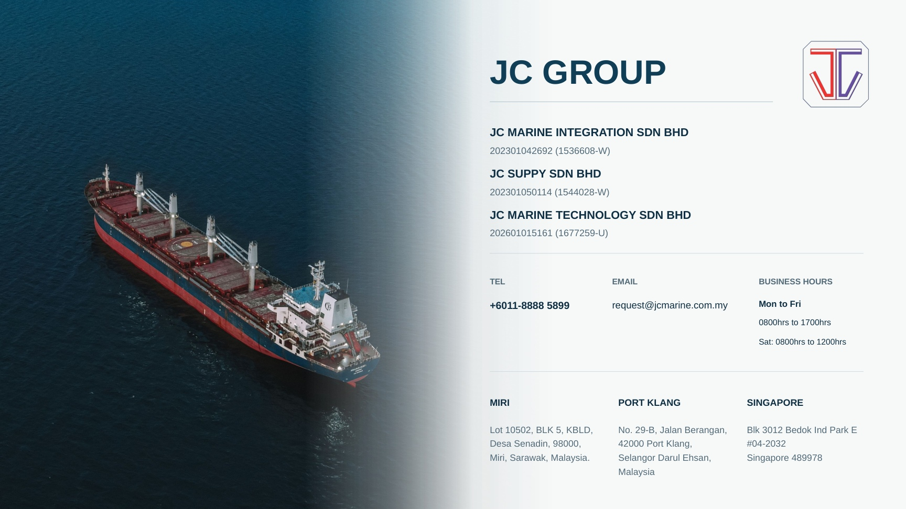

# JC Group · 渐变修正版 PDF

两套均为 **完整 31 页、16:9 横屏 PDF**，沿用已确认的第 1 款封面。照片和中间向右的渐变已合成为不透明背景，文件名使用 `Gradient_Fixed`，便于区分旧版本。封面文字可搜索，JC Logo 保持原样，无演讲者备注页。

- **[下载白色内页版 PDF · Gradient Fixed](./JC_Group_White_31pages_Gradient_Fixed.pdf?raw=true)**
- **[下载紫色内页版 PDF · Gradient Fixed](./JC_Group_Purple_31pages_Gradient_Fixed.pdf?raw=true)**

第 9 页 JRC 与 Alphatron Marine 维持相同显示宽度、原比例及 Authorized distributor 字样；其余 30 页保持原样。
