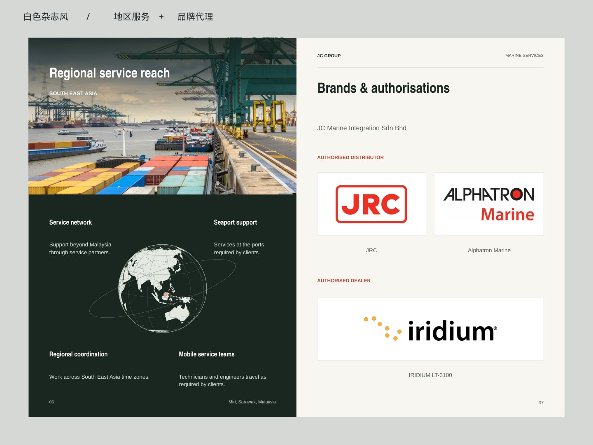
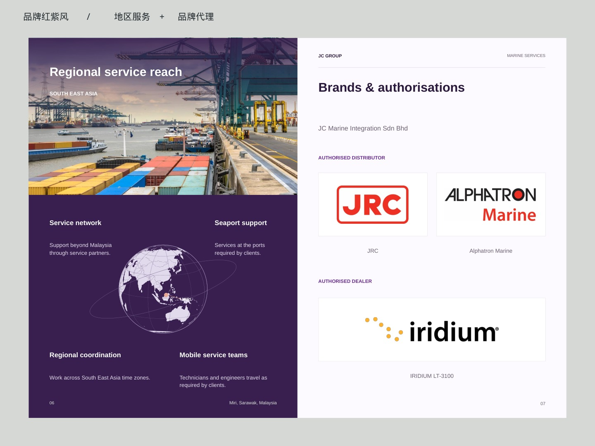

# JC Group · 第 3、5 套竖版精修

按提供的封面／封底参考图重新整理为 A4 比例竖版，每套 22 页。

- 封面：只保留 JC GROUP、公司标志与海事主视觉。
- 内页：集团 → 海事服务 → 卫星通信 → 船舶供应，按公司与业务归类，统一对齐和段落间距。
- 新增独立地区服务页，与品牌代理页相邻；按最新参考图采用大图、地区图示、分组 Logo 展示。
- 封底：服务电话、邮箱、地址和营业时间，采用参考图的联络页布局。
- 配色：第 3 套暖白杂志风；第 5 套克制的品牌红紫风。

**[地区服务／品牌代理双页预览](./01_Regional_Brands_Preview.pdf?raw=true)** · **[封面／封底布局预览 PDF](./00_Cover_Back_Layout_Preview.pdf?raw=true)** · **[两套完整 PPT＋PDF 合集](./JC_Group_03_05_Refined.zip?raw=true)**

| 版本 | 可编辑 PPT | PDF 预览 |
| --- | --- | --- |
| 白色杂志风 | [下载 PPT](./03_Editorial_Refined.pptx?raw=true) | [查看 PDF](./03_Editorial_Refined.pdf?raw=true) |
| 品牌红紫风 | [下载 PPT](./05_Signature_Refined.pptx?raw=true) | [查看 PDF](./05_Signature_Refined.pdf?raw=true) |

资料和原始照片依据所提供的 2025-10-28 JC Group 公司介绍；参考图片仅用于版式，不使用其公司信息。

原稿 `JC SUPPY / JC Supply`、Iridium `dealer / distributor` 存在表述不一致，已保留核对备注。设备名称包括原稿嵌入图片中的项目。
